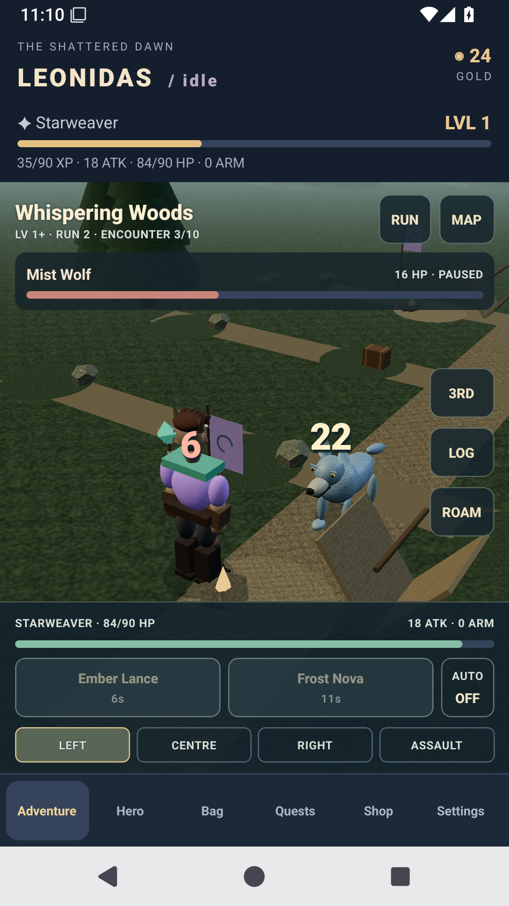
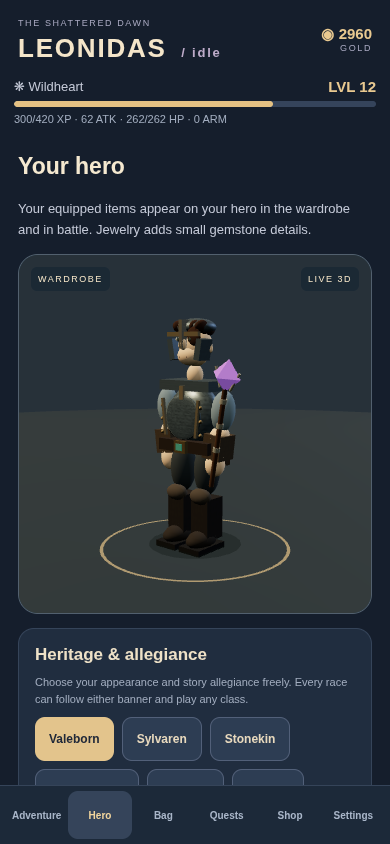

# Leonidas V3 — The Shattered Dawn

An English-language idle roguelike RPG for Android, with a playable 3D frontier, original fantasy story and modular content. Built with React Native, Expo, Three.js and React Three Fiber.

**[Download release 0.4.0: APK + source ZIP](https://github.com/henkdepotvis0180/idleRPGLeonidasv3/releases/tag/v0.4.0)** · [Changelog](CHANGELOG.md) · [Update log](UPDATELOG.md) · [Playing guide](docs/PLAYING.md)

The standalone APK includes the game, models, textures and audio. No account, Expo Go or development server is needed. Android 7.0+, ARM64 and OpenGL ES 3-capable hardware are recommended. This remains a test alpha, using lightweight procedural 3D models; the realistic launcher illustration is promotional artwork.

## Release 0.4.0

- A full-height gameplay viewport with overlaid health, spells and tactical controls.
- Walk around a seeded regional frontier in third person or an aerial view. Switch cameras with a smooth rising/falling transition. The atlas shows destinations and level requirements; pick a site to walk there.
- Eight regions, 24 ordinary enemy definitions, eight bosses and eight original story chapters, including a plague colossus, bound frost dragon and time-bound sovereign.
- Six races and two story factions, visible equipment, articulated movement, regional materials, fog, banners and snow/motes.
- Six permanent companions hired with earned gold: damage, armor or timed healing, with one visible ally following at a time.
- Three combat lanes, three stances and boss attack telegraphs. Stylish outgoing/incoming damage, critical, healing, block and dodge numbers.
- Sixteen slots, five rarity colors and 128 regional equipment catalog entries. Loot adds level, material, origin, lore and design; advanced jewelry can provide critical chance/regeneration.
- Eight distinct spell-school sounds, weapon-specific effects, two original ambient themes and separate music/effects toggles.
- All fourteen classes and twenty-eight abilities, daily/main quests, ten-encounter blessing runs, bags/shop and offline XP/gold remain available.
- Schema-2/3 saves automatically migrate to schema 4; previous progress and equipment are preserved.

 

The game takes broad genre inspiration from fantasy RPGs, with original names, artwork, geometry, maps, item descriptions, stories and synthesized music. The frontier is a regional open-world prototype: selectable regions contain compact walkable generated layouts, rather than a seamless continent or multiplayer world.

## Install or update

Download `idleRPGLeonidasv3-0.4.0.apk` from the release and install it over the existing Leonidas V3 app. The package remains `com.leonidas.idlerpgv3`, Android versionCode is `3`, and the original storage key remains in use. Uninstalling removes local progress; saves do not sync across devices.

The app uses a test signing key for these alpha updates. A fixed private release key is needed before public distribution. Signing keys and credentials must never enter the source archive.

## Development and builds

Download the release's `idleRPGLeonidasv3-0.4.0-source.zip`, or clone the repository. The ZIP contains committed source, the dependency lockfile, documentation and build scripts; it excludes generated native folders, caches and build artifacts.

Requires Node.js 24. Native builds also need JDK 21 and Android SDK platform 36, build tools 36.0.0, NDK 27.1.12297006 and CMake 3.22.1.

```sh
npm ci
npm run typecheck
npm test
npm start
```

Build a standalone APK for ARM64 phones and x86_64 emulators:

```sh
# Set JAVA_HOME and ANDROID_HOME for your machine first.
npm run apk
```

Output: `artifacts/idleRPGLeonidasv3-0.4.0.apk` plus SHA-256. The build script refreshes generated native configuration. To archive a tested commit from a Git checkout, use `npm run zip`; GitHub Actions does this automatically.

```sh
npx playwright install chromium
npm run test:ui
# CHROMIUM_PATH may select an existing Chromium.
```

GitHub Actions runs strict TypeScript, gameplay/save tests, real WebGL/browser interactions, a native APK build and an installed-APK Android emulator check. The publication workflow waits for all of them and publishes the exact tested commit's APK, source ZIP, checksums and changelog.

## Extend the game

| Module | Purpose |
| --- | --- |
| `src/content/classes.ts` | Fourteen classes, weapon styles and ability kits |
| `src/content/zones.ts` | Regions, enemies, bosses/telegraphs and story |
| `src/content/world.ts` | Races, factions, companions, stances, biomes and seeded sites |
| `src/content/itemFactory.ts` | Regional item materials, designs, lore and vendor catalog |
| `src/content/gear.ts` | Slots, introductory shop gear and rarity distributions |
| `src/content/quests.ts` | Daily objectives and run blessings |
| `src/config.ts` | Independent modules and economy/run/offline rules |
| `src/engine.ts` | Pure gameplay transitions, walking/combat and save migration |
| `src/visuals/` | Original models, materials, animation, regional scenery and cameras |
| `src/components/` | Gameplay HUD, atlas, wardrobe, company, market and native/web canvas adapters |
| `src/audio/` | Sound-school mapping and lifecycle |
| `scripts/generate-audio.py` | Reproducible original music/SFX |

See [the extension guide](docs/EXTENDING.md), [class guide](docs/CLASSES.md), [playing guide](docs/PLAYING.md) and [asset provenance](assets/ATTRIBUTION.md).
